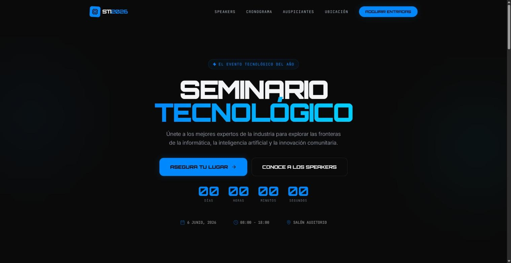

<div align="center">

# STI 2026 — Seminario Tecnológico Informático

**Sitio oficial del seminario, con inscripción en línea y panel de administración**

[](https://www.seminarioucsi.com)




</div>

---

## Sobre el proyecto

Sitio web del **Seminario Tecnológico Informático 2026**: presenta el evento, sus speakers,
el cronograma y los auspiciantes, y gestiona la inscripción de los asistentes de punta a punta,
desde el formulario hasta el correo de confirmación y la administración de los registros.

## Funcionalidades

### Sitio público
- 🚀 Portada con cuenta regresiva al evento, fecha, horario y lugar.
- 🎤 Sección de **speakers** con sus perfiles.
- 🗓️ **Cronograma** completo de la jornada.
- 🤝 Muro de **auspiciantes**.
- 📍 Ubicación del evento.

### Inscripción (`/registros`)
- 📝 Formulario de registro con validación de datos.
- ✉️ Correo de **confirmación automático** al inscribirse (Resend), enviado desde una función serverless.
- 🔒 La cédula es única: no se permiten inscripciones duplicadas.

### Panel de administración (`/admin`)
- 📋 Listado de inscriptos con búsqueda.
- 🗑️ Eliminación de registros.
- 📤 Exportación de los inscriptos a **CSV**.

## Tecnologías

| Capa | Tecnología |
|---|---|
| Frontend | React · TypeScript · React Router · Motion · Lucide |
| Estilos | Tailwind CSS |
| Build | Vite |
| Base de datos | Supabase (PostgreSQL) |
| Correo | Resend |
| Backend | Función serverless en `api/` (Vercel) · servidor Express para desarrollo local |
| Hosting | Vercel |

## Estructura

```
├── api/register.ts          # Función serverless: registro + correo de confirmación
├── server.ts                # Servidor Express equivalente para desarrollo local
├── src/
│   ├── App.tsx              # Landing: hero, speakers, cronograma, auspiciantes
│   ├── pages/
│   │   ├── RegistrationPage.tsx
│   │   └── AdminPage.tsx
│   └── lib/supabase.ts      # Cliente de Supabase
├── supabase/migrations/     # Esquema de la tabla de inscripciones
└── public/                  # Fotos de speakers y logos de auspiciantes
```

## Cómo ejecutarlo

**Requisitos:** Node.js 20+ y un proyecto de Supabase.

```bash
git clone https://github.com/Zephixd/seminarioucsi.git
cd seminarioucsi
npm install
cp .env.example .env        # completar las variables
```

Crear la tabla ejecutando `supabase/migrations/create_registrations_table.sql` en el SQL Editor de
Supabase (detalles en [`SUPABASE_SETUP.md`](SUPABASE_SETUP.md)). Luego:

```bash
npm run dev:all             # frontend (puerto 3000) + API local
```

### Variables de entorno

| Variable | Uso |
|---|---|
| `VITE_SUPABASE_URL` | URL del proyecto de Supabase |
| `VITE_SUPABASE_ANON_KEY` | Clave pública (anon) de Supabase |
| `SUPABASE_SERVICE_ROLE_KEY` | Solo para `setup-db.ts`; nunca se expone al cliente |
| `RESEND_API_KEY` | Envío de correos de confirmación |

## Autor

**Mathias Sebastian Britos Griffith** — *GreenKnow*
Estudiante de Ingeniería Informática · Universidad Católica «Nuestra Señora de la Asunción», Unidad Pedagógica San Ignacio Guazú

[](https://greenknow-portfolio.vercel.app)
[](https://github.com/Zephixd)
